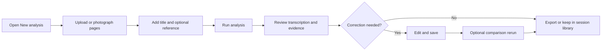
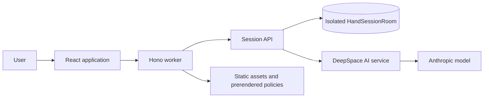

# H.A.N.D

**Handwritten Analysis & Note Digitization** turns photos and scans of handwritten academic notes into structured, reviewable text. Users can add optional reference material to identify supported concepts, omissions, discrepancies, and unsupported additions with a deterministic correspondence score.

[Open H.A.N.D](https://hand.592industries.com/) · [User guide](docs/02-user-guide.md) · [Architecture](docs/04-system-architecture.md) · [Privacy model](docs/07-session-and-privacy.md)

> This branch is the public documentation edition of H.A.N.D and intentionally contains no application source code, deployment configuration, dependencies, tests, or credentials. The maintained product source is on [`main`](https://github.com/592industries/hand/tree/main).

**Current documented implementation:** v2.2.1, source commit `605adbcb` on `feature/v2.2.1`. This statement identifies the implementation snapshot; it does not claim that a production tag or release was published.

## What H.A.N.D does

- Accepts up to six HEIC, JPEG, PNG, or WebP note images, including a device-camera option, and normalizes large phone photos before upload.
- Produces a structured transcription with sections, equations, concepts, a summary, legibility, and uncertainty markers.
- Optionally compares the transcription with user-supplied text or Markdown reference material.
- Validates comparison evidence and calculates the final score in application code.
- Preserves the original model output when a user corrects the transcription.
- Starts findings collapsed and uses structured, interface-consistent transcription typography for focused review.
- Keeps recent work in an isolated temporary session for review, search, export, and deletion.
- Exports Markdown and JSON in the browser.

AI output can be wrong. H.A.N.D is a study and organization tool, not an authoritative grade or source. See the [AI Accuracy Notice](https://hand.592industries.com/ai-disclaimer).

## User journey



## Architecture



The frontend and API deploy together as a DeepSpace application on Cloudflare Workers. A random secure cookie selects one SQLite-backed Durable Object session. The browser never receives provider credentials. See [System Architecture](docs/04-system-architecture.md) and the [diagram collection](diagrams/architecture-overview.md).

## Privacy summary

H.A.N.D does not require an account, name, email address, or payment information. Account-free does not mean data-free: it processes note images, optional reference material, metadata, transcriptions, corrections, results, a random session identifier, and operational counters.

Browser connections and valid session activity refresh the session timestamp. When activity stops, H.A.N.D schedules application-data cleanup after 30 minutes. Users can also clear the current session in Settings. The 30-minute window does not control AI-provider logs, infrastructure records, browser caches, or downloaded exports. Read [Session and Privacy](docs/07-session-and-privacy.md), the [data inventory](docs/DATA_INVENTORY.md), and the public [Privacy Policy](https://hand.592industries.com/privacy).

## Technology

| Area | Verified implementation |
|---|---|
| Frontend | React 19, TypeScript, Vite 8, React Router/Generouted, Tailwind CSS 4 |
| Worker API | Hono on Cloudflare Workers through DeepSpace |
| Session storage | SQLite-backed Durable Object (`HandSessionRoom`) |
| AI | DeepSpace server-side AI proxy, Anthropic `claude-sonnet-5`, AI SDK structured output, Zod |
| Validation | Zod schemas plus browser normalization, image signatures, verified dimensions, and byte limits |
| Testing | Vitest and Playwright through the DeepSpace test runner |
| Delivery | GitHub Actions and `npx deepspace deploy` after checks pass on `main` |

## Documentation

| Chapter | Purpose |
|---|---|
| [01 — Overview](docs/01-overview.md) | Product purpose, users, boundaries, and capabilities |
| [02 — User Guide](docs/02-user-guide.md) | Step-by-step use and recovery guidance |
| [03 — Product Requirements](docs/03-product-requirements.md) | Implemented and partial requirements with evidence |
| [04 — System Architecture](docs/04-system-architecture.md) | Components, boundaries, storage, and request flow |
| [05 — Analysis Pipeline](docs/05-analysis-pipeline.md) | Validation, AI processing, persistence, and failures |
| [06 — Scoring and Comparison](docs/06-scoring-and-comparison.md) | Reference suitability, findings, and score formula |
| [07 — Session and Privacy](docs/07-session-and-privacy.md) | Cookie, isolation, retention, deletion, and providers |
| [08 — API and Data Contracts](docs/08-api-and-data-contracts.md) | Session endpoints, envelopes, schemas, and limits |
| [09 — Verification and Validation](docs/09-verification-validation.md) | Test layers, commands, observed results, and gaps |
| [10 — Deployment and Operations](docs/10-deployment-and-operations.md) | CI/CD, bindings, release flow, and recovery |
| [11 — Limitations and Tradeoffs](docs/11-limitations-and-tradeoffs.md) | Current boundaries and future considerations |
| [12 — Development Guide](docs/12-development-guide.md) | Setup, commands, contribution, and safe testing |
| [13 — Accessibility and Usability](docs/13-accessibility-and-usability.md) | Implemented behavior and audit gaps |
| [14 — Glossary](docs/14-glossary.md) | Product and engineering terminology |
| [15 — Traceability Matrix](docs/15-traceability-matrix.md) | Major claims mapped to code, tests, and configuration |
| [16 — Release History](docs/16-release-history.md) | Version-by-version implementation and verification record |

Evidence appendices: [Data Inventory](docs/DATA_INVENTORY.md) · [Privacy and Security Review](docs/PRIVACY_SECURITY_REVIEW.md) · [Policy Decisions](docs/POLICY_DECISIONS.md)

Diagrams: [System Context](diagrams/system-context.md) · [Architecture](diagrams/architecture-overview.md) · [Analysis](diagrams/analysis-workflow.md) · [Comparison](diagrams/reference-comparison.md) · [Session](diagrams/session-lifecycle.md) · [Request](diagrams/request-sequence.md) · [Deployment](diagrams/deployment-pipeline.md) · [Data Boundaries](diagrams/data-boundaries.md)

## Development and verification

Node 22, 24, or 26 and npm 11.6 or newer are required.

```bash
npm install
npx deepspace auth login
npx deepspace app init
npm run dev
```

Before a pull request:

```bash
npm run type-check
npm run lint
npm run test:unit
npm run build
npx deepspace test run all
```

Automated tests do not make paid model calls. See the [Development Guide](docs/12-development-guide.md) and the product source's [Environment Reference](https://github.com/592industries/hand/blob/main/ENVIRONMENT.md).

## Deployment

Pushes to `main` start the GitHub Actions workflow. It installs dependencies and Chromium system libraries, authenticates with the `DEEPSPACE_SESSION` repository secret, runs type, lint, and the complete DeepSpace test suite, then deploys. Feature and documentation branches do not deploy production.

## Known limits

- No account recovery or cross-device session sync.
- Six normalized images, 8 MB per image, 30 MB combined, and 20 analyses per session.
- Six AI calls per rolling ten-minute session window.
- Reference text must be suitable before a score is available.
- AI transcription and comparison can be wrong.
- Cleanup is activity-based and does not set provider retention.
- No claim of WCAG conformance, penetration testing, or formal security certification.

See [Limitations and Tradeoffs](docs/11-limitations-and-tradeoffs.md).

## Releases
- v2.2.2 — Improved mobile reliability with Safari-compatible startup, immediate branded loading feedback, optimized initial bundle loading, resilient session reconnection, and small-screen safe-area support; builds on the upload normalization, image validation, and session cleanup improvements introduced in v2.2.1.
- v2.2.1 — upload normalization, actual image-header validation, collapsed findings, transcription typography, and race-safe session cleanup; implementation commit `605adbcb`.
- v2.2.0 — progress-aware background analysis and the focused document-review workspace; implementation commit `6fde22bb`.
- v2.1.0 — blue brand integration, public policies, and privacy/security documentation; implementation commit `7050b917`.
- [v2.0.0](https://github.com/592industries/hand/releases/tag/v2.0.0) — interface redesign and account-free workspace refinement.
- [v1.0.0](https://github.com/592industries/hand/releases/tag/v1.0.0) — optimized H.A.N.D brand assets.

Implementation versions listed without a linked GitHub release describe the maintained source commit and are not a claim that a release tag was published.

H.A.N.D is a [592 Industries](https://592industries.com/) product.
