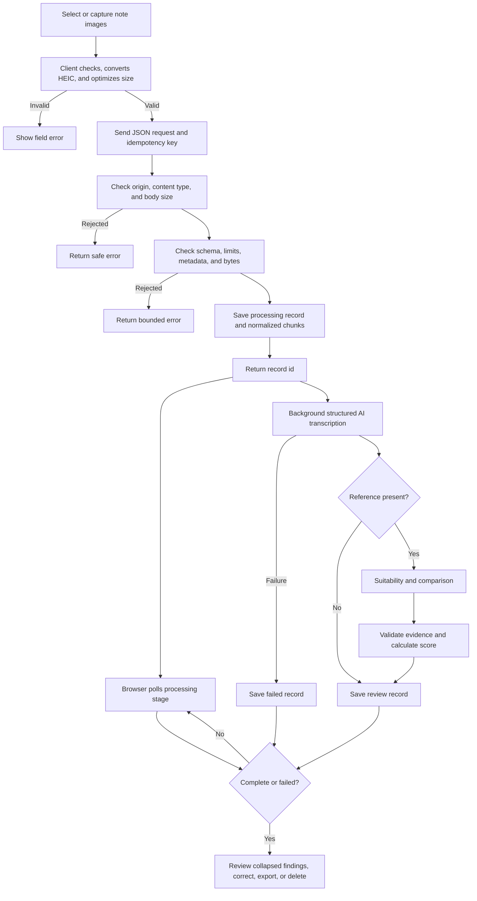

# Analysis Workflow

Persistence occurs before inference so a failed operation has a visible session record. The model proposes comparison dimensions; application code owns final scoring.

[Analysis Pipeline](../docs/05-analysis-pipeline.md) · [Reference Comparison](reference-comparison.md) · [Documentation home](../README.md)
