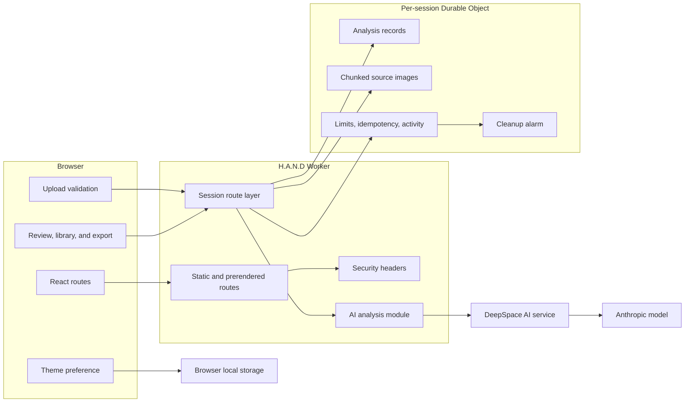

# Architecture Overview

The browser never receives model credentials. The cookie-selected room is the record and file boundary.

[System Architecture](../docs/04-system-architecture.md) · [Request Sequence](request-sequence.md) · [Documentation home](../README.md)
