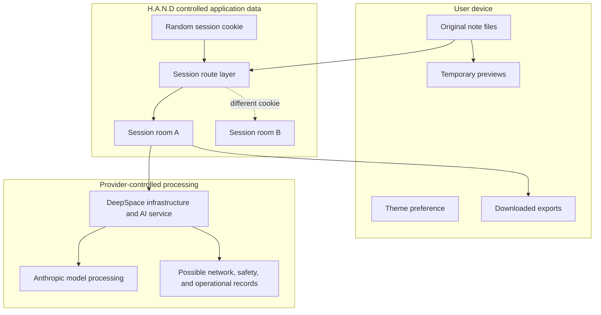

# Data Boundaries

Application cleanup deletes the selected room's records. It does not delete user exports or prove deletion from provider-controlled records. Session A cannot select Session B using an analysis id alone.

[Data Inventory](../docs/DATA_INVENTORY.md) · [Privacy and Security Review](../docs/PRIVACY_SECURITY_REVIEW.md) · [Documentation home](../README.md)
