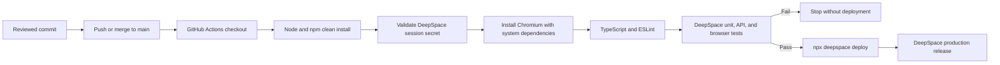

# Deployment Pipeline

Feature and `case-study` branches do not trigger production deployment. The workflow authenticates with the GitHub repository secret `DEEPSPACE_SESSION`.

[Deployment and Operations](../docs/10-deployment-and-operations.md) · [Verification](../docs/09-verification-validation.md) · [Documentation home](../README.md)
