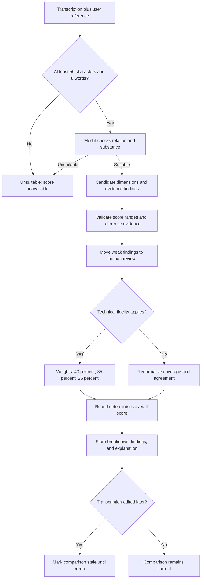

# Reference Comparison and Scoring

The score measures correspondence with the supplied reference only.

[Scoring and Comparison](../docs/06-scoring-and-comparison.md) · [AI Accuracy Notice](https://hand.592industries.com/ai-disclaimer) · [Documentation home](../README.md)
