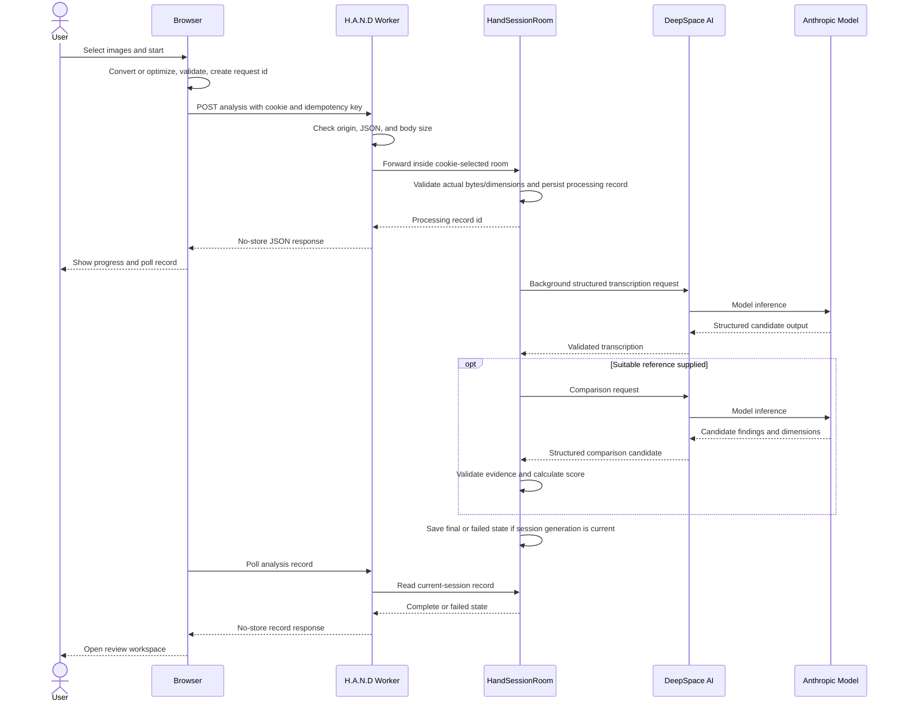

# Analysis Request Sequence

The initial response returns a processing record id. Polling later exposes the complete or failed record, allowing the user to review or delete it.

[API and Data Contracts](../docs/08-api-and-data-contracts.md) · [Analysis Pipeline](../docs/05-analysis-pipeline.md) · [Documentation home](../README.md)
