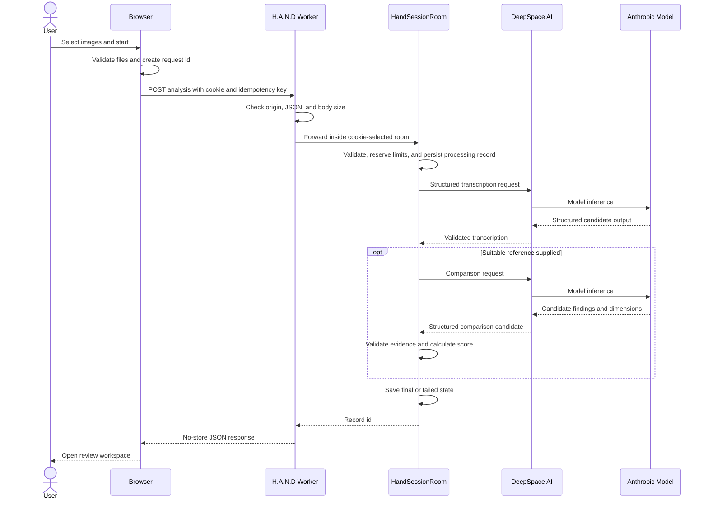

# Analysis Request Sequence

The response can report a failed record while still returning its id, allowing the user to see and delete the failed item.

[API and Data Contracts](../docs/08-api-and-data-contracts.md) · [Analysis Pipeline](../docs/05-analysis-pipeline.md) · [Documentation home](../README.md)
