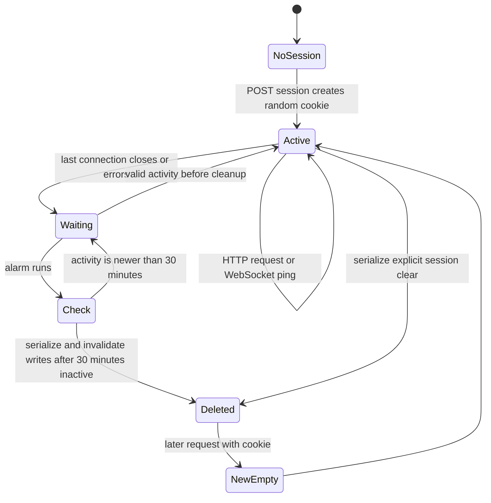

# Session Lifecycle

The cookie has no fixed 30-minute expiry. The room's stored activity and alarm control application cleanup. A generation guard prevents older analysis work from restoring a deleted room. Provider records and downloaded files are outside this lifecycle.

[Session and Privacy](../docs/07-session-and-privacy.md) · [Data Inventory](../docs/DATA_INVENTORY.md) · [Documentation home](../README.md)
