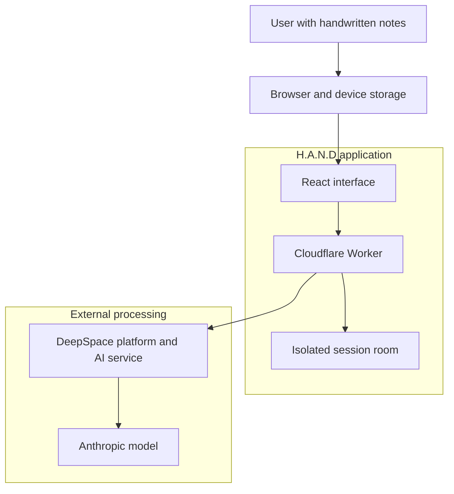

# System Context

H.A.N.D runs as a browser application and worker-backed session service. The AI boundary is external to application-controlled session storage.

H.A.N.D controls application validation, prompts, scoring, and session records. DeepSpace and Anthropic control their respective infrastructure and provider processing.

[Architecture chapter](../docs/04-system-architecture.md) · [Data Boundaries](data-boundaries.md) · [Documentation home](../README.md)
