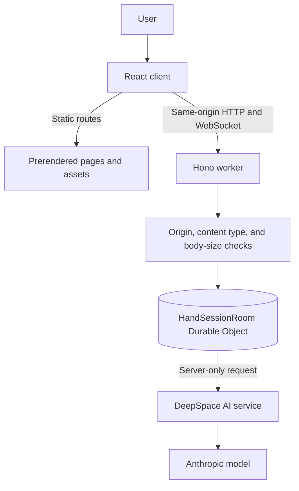

# 04 — System Architecture

[Documentation home](../README.md) · [Previous: Product Requirements](03-product-requirements.md) · [Next: Analysis Pipeline](05-analysis-pipeline.md)

H.A.N.D is one DeepSpace-native application deployed as a Cloudflare Worker with bundled static assets. The worker owns the same-origin session API and routes each random browser session to one `HandSessionRoom` Durable Object. AI access is server-only through DeepSpace.

## Components

| Component | Responsibility |
|---|---|
| React application | Routing, HEIC conversion and upload normalization, editing, library, export, theme, and policy UI |
| Hono worker | Security headers, APIs, static fallback, and platform bindings |
| Session route layer | Cookie creation, same-origin enforcement, JSON/body checks, and room selection |
| HandSessionRoom | CRUD, image chunks, idempotency, limits, background AI orchestration, connection state, serialized storage, and cleanup |
| Analysis module | Model calls, prompt boundary, structured output, evidence validation, and scoring handoff |
| DeepSpace | Build/deploy tooling, Cloudflare integration, Durable Objects, and AI proxy |
| Anthropic | Model inference for transcription and comparison |

## Routes

Workspace routes under `(app)` open the temporary session connection: `/home`, `/new`, `/library`, `/analysis/:id`, and `/settings`. Public policy routes do not open it and are prerendered. The root redirects to `/new`; unknown application paths show a branded 404 page.

## Security and storage boundary

Mutations and WebSocket upgrades must be same-origin. Non-GET writes require JSON except deletion. The worker applies a 42 MB body ceiling, which accommodates the base64 form of the 30 MB normalized image total plus reference and JSON metadata. Analysis ids do not select storage globally: the cookie selects the room first. Images are private and no-store.

Room storage contains an ordered id list, serialized analysis records, 1.5 MB image/record chunks, idempotency entries, AI-call timestamps, and `lastSeen`. There is no separate application database or object store. Storage mutations use a per-room queue. Cleanup increments a generation marker before deleting the selected room, so older background work cannot repopulate it; failed chunk writes remove their known partial keys.

## Static delivery

Vite bundles the client and worker. The prerender plugin writes the root and five policy pages as static HTML, generates the sitemap, and keeps a SPA shell for dynamic routes. Brand assets use immutable caching.

## Related diagrams

[System Context](../diagrams/system-context.md) · [Architecture](../diagrams/architecture-overview.md) · [Request Sequence](../diagrams/request-sequence.md) · [Data Boundaries](../diagrams/data-boundaries.md)
