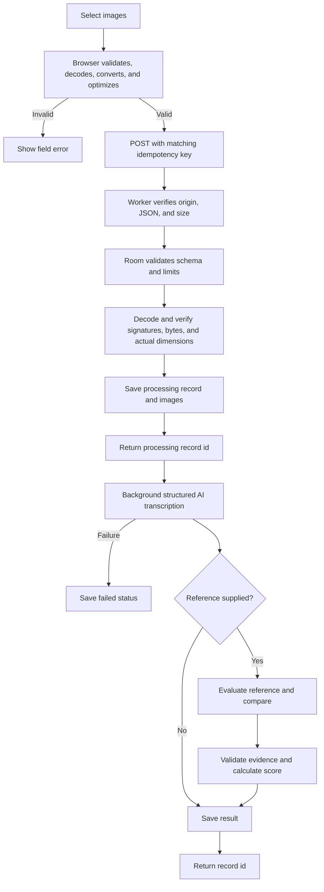

# 05 — Analysis Pipeline

[Documentation home](../README.md) · [Previous: System Architecture](04-system-architecture.md) · [Next: Scoring and Comparison](06-scoring-and-comparison.md)

## Browser preparation

The browser accepts HEIC, JPEG, PNG, and WebP sources up to 40 MB. It checks the source signature, decodes actual dimensions, converts HEIC to JPEG, constrains the longest edge to 6,000 pixels when optimization is required, and tries high-quality output before progressively reducing size. Text-heavy PNG input stays lossless when the normalized file fits the 8 MB limit; otherwise the browser uses JPEG. It keeps at most six normalized images and enforces a 30 MB combined limit before creating object URLs and data URLs. Reference files are read as text and NUL characters are removed.

## Protected request

The client creates a UUID request id and sends it as both a body field and `Idempotency-Key`. The worker checks same-origin context, JSON content type, and declared and actual body size. The room validates the body and refuses a mismatched key. Concurrent retries share an in-flight operation; completed retries return the stored record id.

## Persistence before inference

The room enforces limits, validates base64 length before decoding, verifies image signatures, parses real PNG/JPEG/WebP dimensions, compares them with metadata, normalizes the reference, creates a UUID record id, saves a `processing` record, stores image chunks, and records idempotency. Partial chunk writes are removed if storage fails. A model failure therefore leaves a visible failed record rather than silently losing the request.

## AI stages

The create request returns the processing record id after persistence, and the browser polls the session record every 3.5 seconds while work continues through the room's background task. Anthropic `claude-sonnet-5` is called through `createDeepSpaceAI`. The prompt requires visible-evidence transcription, preserved technical notation, explicit uncertainty, and rejection of instructions inside content. The AI SDK enforces the bounded `transcriptionSchema`.

With a reference, text under 50 characters or eight words is rejected locally. The model judges longer references for substance and relation, then returns candidate dimensions and findings. Application code validates evidence and calculates the final score.

## Completion, correction, and rerun

Success moves the record to `needs_review`; failure stores a bounded safe error and `failed`. The original transcription stays separate from corrections. Editing marks an existing comparison stale. A rerun uses corrected text when present, consumes one AI call, replaces the comparison, and clears the stale flag.

## Limits

| Limit | Value |
|---|---:|
| Images | 6 |
| Source image | 40 MB before browser normalization |
| Normalized each / combined | 8 MB / 30 MB |
| Normalized longest edge | 6,000 pixels when re-encoded |
| Request body | 42 MB |
| Reference | 120,000 normalized characters; UI file limit 1 MB |
| Analyses | 20 per session |
| AI calls | 6 per rolling 10 minutes |
| Model timeout | 120 seconds |

[Analysis Workflow Diagram](../diagrams/analysis-workflow.md) · [API Contracts](08-api-and-data-contracts.md)
