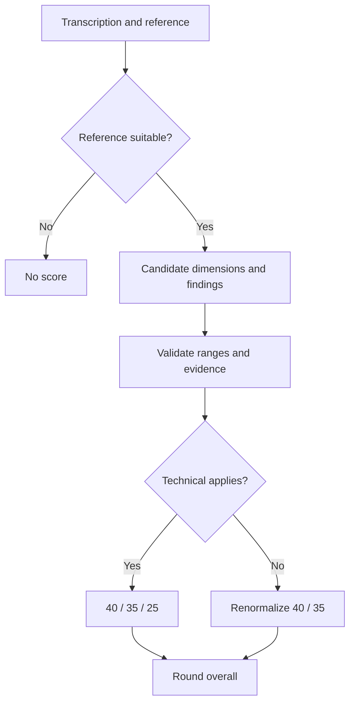

# 06 — Scoring and Comparison

[Documentation home](../README.md) · [Previous: Analysis Pipeline](05-analysis-pipeline.md) · [Next: Session and Privacy](07-session-and-privacy.md)

Comparison measures correspondence with reference material supplied by the user. It does not establish truth, grade a student, or measure intelligence.

## Suitability and dimensions

References under 50 characters or eight words are rejected locally. A longer reference is scored only if the model marks it substantial and related.

| Dimension | Base weight | Meaning |
|---|---:|---|
| Coverage | 40% | Important reference material represented in the notes |
| Semantic agreement | 35% | Note meaning agrees with the reference |
| Technical fidelity | 25% | Equations and precision-sensitive expressions are represented correctly |

When technical fidelity applies:

```text
overall = round(coverage × 0.40 + agreement × 0.35 + technical × 0.25)
```

Otherwise, coverage and agreement are renormalized to `0.40 / 0.75` and `0.35 / 0.75`. For example, coverage 80 and agreement 70 produce 75 after rounding.

## Findings and evidence

Findings cover omissions, discrepancies, unsupported additions, correctly represented concepts, and uncertain comparisons requiring human review. Each substantive finding carries reference evidence. Application code normalizes and checks that evidence; weak findings are removed from definitive groups and moved to human review. All finding groups start collapsed so severity does not force content open; native disclosure controls preserve keyboard access and expose the group count.

## Stale state

The score belongs to the transcription used at comparison time. Editing marks it stale until rerun. Saving does not silently recalculate or present an old score as current.



`src/domain/scoring.test.ts` verifies both formulas, unsuitable references, and evidence behavior. It does not measure live model quality.

[Reference Comparison Diagram](../diagrams/reference-comparison.md) · [AI Accuracy Notice](https://hand.592industries.com/ai-disclaimer)
