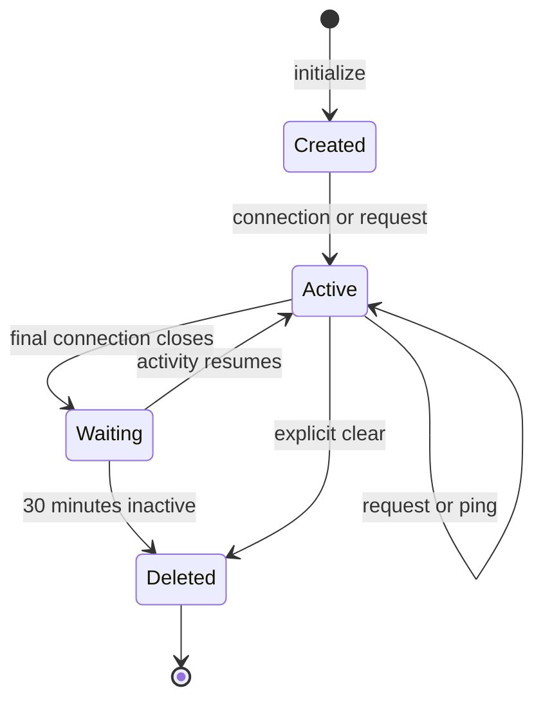

# 07 — Session and Privacy

[Documentation home](../README.md) · [Previous: Scoring and Comparison](06-scoring-and-comparison.md) · [Next: API and Data Contracts](08-api-and-data-contracts.md)

## Account-free model

H.A.N.D does not create a profile or ask for identity or payment fields. Workspace initialization creates a random 256-bit identifier in the `__Host-hand-session` cookie. Verified attributes are `Path=/`, `HttpOnly`, `Secure`, and `SameSite=Strict`; no fixed browser expiry is set.

The identifier selects one Durable Object room. Record and image lookups happen inside it. Analysis ids alone cannot select another room. Images return as private, no-store responses.

## Lifecycle

Requests, connection events, and pings can refresh `lastSeen`. With no open WebSocket, an alarm is set 30 minutes from that activity. It reschedules if the room became active and otherwise deletes only that room's storage. Storage changes and cleanup are serialized inside the room. Cleanup changes a generation marker, and background analysis checks it before saving, so work started before deletion cannot restore expired files or records. This is scheduled inactivity cleanup, not a per-request signed expiry guarantee.

## Data and browser storage

The room stores normalized image chunks, metadata, references, original and corrected transcription, comparisons, scores, statuses, timestamps, ids, rate counters, idempotency keys, and activity time. Original selected files and conversion buffers remain in browser memory; the browser also uses the essential cookie, local storage for theme, session storage for one recovery marker, and temporary object URLs for previews.

No advertising or audience-analytics SDK, IndexedDB store, or service worker is present in the inspected application.

## External processing

Images and relevant text pass through DeepSpace's AI service to Anthropic. H.A.N.D cleanup does not control proxy or provider logs, security records, backups, browser caches, or exported files. The repository does not prove a zero-retention agreement.

Settings clears application data in the current room. Individual deletion removes one analysis and its image chunks. Clearing the cookie can remove access before server cleanup.

## Evidence

[Privacy Policy](https://hand.592industries.com/privacy) · [Cookie Policy](https://hand.592industries.com/cookies) · [Data Inventory](DATA_INVENTORY.md) · [Security Review](PRIVACY_SECURITY_REVIEW.md) · [Session Diagram](../diagrams/session-lifecycle.md)
