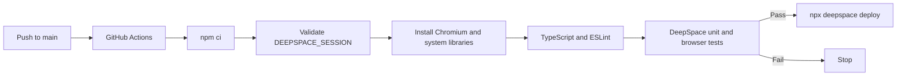

# 10 — Deployment and Operations

[Documentation home](../README.md) · [Previous: Verification](09-verification-validation.md) · [Next: Limitations and Tradeoffs](11-limitations-and-tradeoffs.md)

## Environments

Local development uses `npx deepspace dev start`, Vite, and Miniflare-backed platform emulation. Production runs on Cloudflare Workers through DeepSpace. The application configuration is in `wrangler.toml`; platform and credential details are summarized in `ENVIRONMENT.md`.

## Automated pipeline



Only pushes to `main` and manual workflow dispatch trigger the deployment job. A concurrency group prevents overlapping production jobs. GitHub supplies one repository secret, `DEEPSPACE_SESSION`, to authenticate the CLI; it is not a DeepSpace application variable.

## Quality gates

The workflow performs a clean npm install, validates the session secret, confirms DeepSpace identity, installs Playwright's Chromium dependencies, runs type and lint checks, and runs `npx deepspace test run all`. Deployment is the final step and cannot run if an earlier step fails.

## Runtime bindings

`SESSION_ROOMS` is the application-owned anonymous storage boundary. `ASSETS`, `API_WORKER`, the app identity token, owner credential, app id/name, and standard scaffold Durable Object bindings are supplied or initialized through DeepSpace. H.A.N.D requires no direct Anthropic API key.

## Releases

Application changes are developed on feature branches, reviewed, and merged to `main`. GitHub Actions deploys the merged checkout. Version tags and release notes should describe only reviewed, shipped state. The `case-study` branch is documentation-only and must not be used as a production source branch.

## Health and recovery

`GET /api/session/health` is the local and automated readiness target for the application route. DeepSpace release and rollback commands provide platform release recovery. Operators should inspect the workflow result and DeepSpace release state before declaring deployment success.

Safe operational commands include:

```bash
npx deepspace auth whoami
npx deepspace status
npx deepspace releases
npx deepspace logs
```

Use `npx deepspace rollback` only after identifying the target release and impact. Never put session tokens or owner credentials on a command line, in documentation, or in a commit.

## Monitoring limits

The application provides a health route and safe error responses but does not include a separate analytics, APM, or error-reporting SDK. Provider-level request and worker logs may exist. Alerting, log retention, branch protection, and external uptime monitoring were not verified from repository code.

[Deployment Pipeline Diagram](../diagrams/deployment-pipeline.md) · [Environment Reference](../ENVIRONMENT.md) · [DeepSpace guidance](../AGENTS.md)
